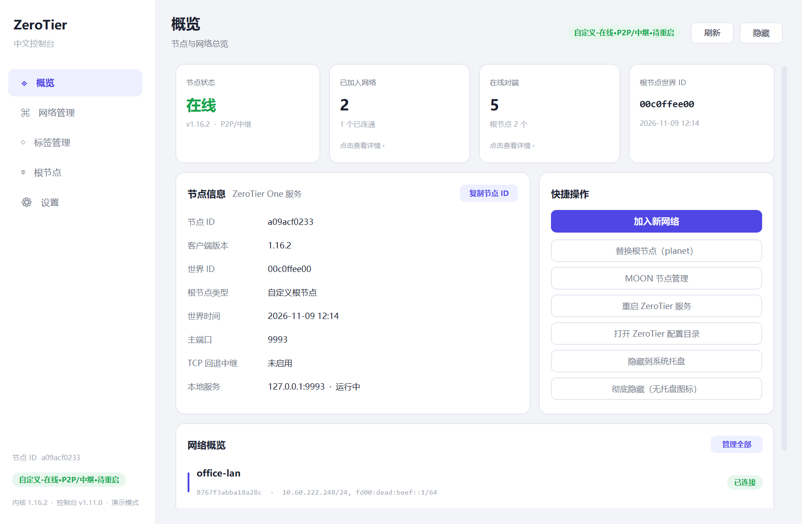
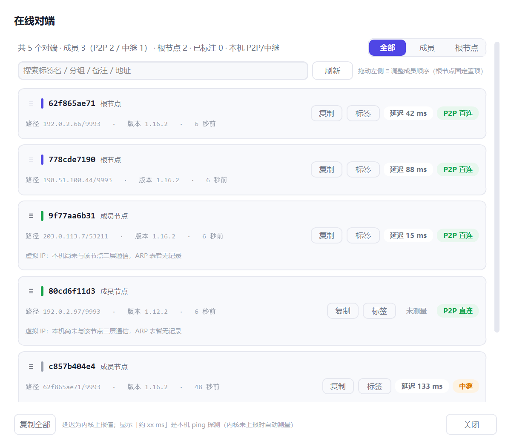
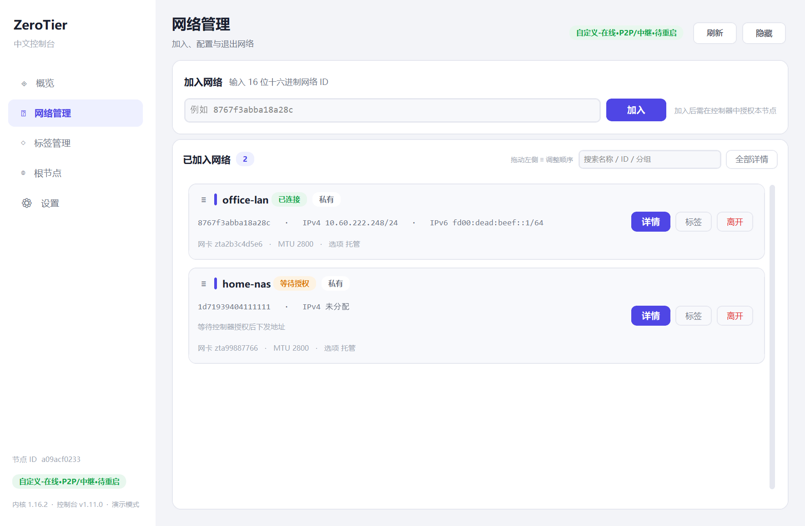
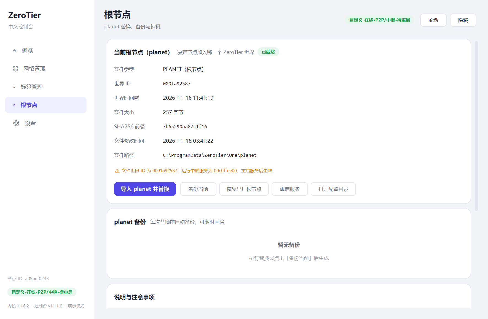
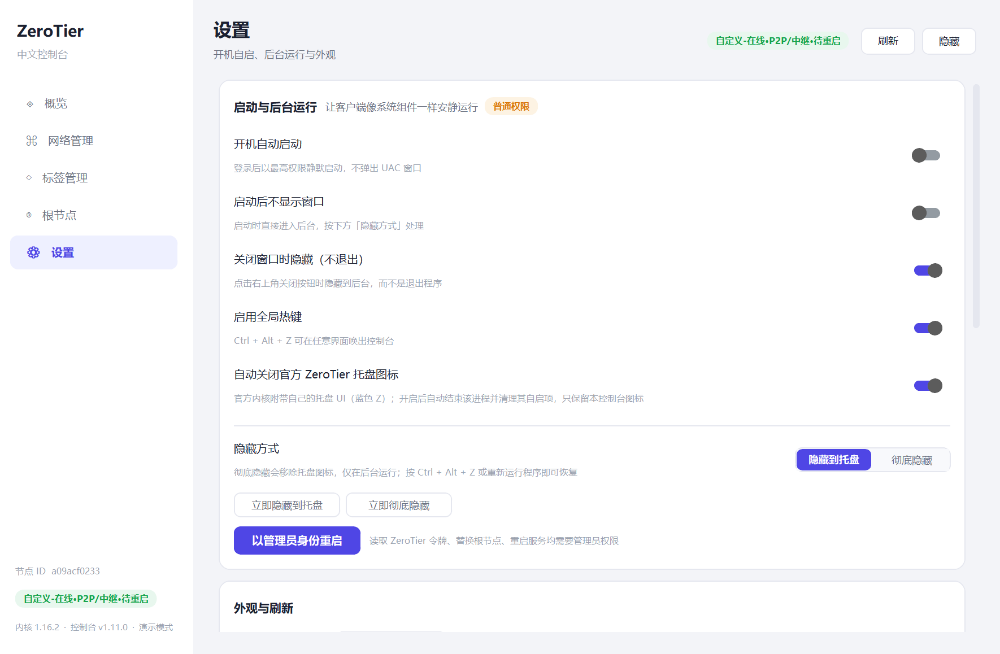

# ZTCenter · ZeroTier 第三方中文控制台

[](LICENSE)
[](#系统要求)
[](#从源码构建)
[](CHANGELOG.md)

> **非官方项目**：与 ZeroTier, Inc. 无任何隶属或背书关系。本项目不修改、不替换官方二进制，
> 只通过官方的本地 HTTP API（`127.0.0.1:9993`）读写节点状态。

一个把 ZeroTier One 在 Windows 上"能看懂、能管得住"的中文图形界面：全中文、深色/浅色主题、
网络与对端信息一目了然、根节点（planet）与 MOON 可视化替换、托盘驻留与开机自启。

---

## 为什么用它

官方 Windows 客户端功能完整，但界面偏英文、缺少这几件日常操作：**给网络起中文名、看清每个对端的
公网 IP 与 P2P/中继状态、安全地替换 planet、后台静默驻留**。ZTCenter 只做这些补充，其余仍交给官方服务。

| | 官方客户端 | ZTCenter |
| --- | --- | --- |
| 界面语言 | 英文 | 简体中文 |
| 网络标识 | 只能看 16 位 ID | 自定义名称 / 颜色 / 分组 / 备注 |
| 对端可见性 | 仅地址 | 地址、公网路径、虚拟 IP、**P2P 直连 / 中继**、延迟、最后收发 |
| planet / MOON | 手工替换文件 | 图形化导入、自动备份、一键回滚 |
| 托盘与自启 | 有 | 两种隐藏方式（托盘 / 彻底隐藏）+ 最高权限计划任务自启 |
| 内核升级 | 手动下载 | 应用内下载，或手动指定本地 MSI |

## 功能

**界面**
- 全中文，浅色 / 深色主题，界面缩放跟随系统 DPI（100%~200%）或手动指定
- 高 DPI 自适应，150% 缩放下不错位

**网络管理**
- 加入 / 退出网络，16 位 ID 格式校验
- 列表行内直接显示 **16 位网络 ID、IPv4/IPv6、虚拟网卡、MTU、已开启选项**
- 右键菜单：复制 ID / IP、**快速切换** 托管配置 / 全局 IP / 默认路由 / 网络 DNS、刷新、详情、退出
- 拖拽调整顺序并被记住；「全部详情」汇总一次复制

**根节点与 MOON**
- planet：查看世界 ID、导入替换（校验类型字节 / 世界 ID / 时间戳）、自动备份、恢复备份或出厂备份
- MOON：导入 `.moon` 文件或粘贴 Hex/Base64，自动 `orbit`，区分「已生效 / 待生效」，删除前备份

**对端**
- 每个对端可打**本地标签**（名称 / 颜色 / 分组 / 备注），按分组归类，支持搜索
- **根节点固定置顶**，其余可拖拽排序并记忆
- 延迟缺失时自动用本机 ping 补一个参考值（明确标注"约"）

**系统集成**
- 托盘常驻，关闭窗口默认隐藏；支持「彻底隐藏」（无托盘图标）
- 开机自启走计划任务（最高权限，不弹 UAC），可在设置中开关
- 全局热键 `Ctrl + Alt + Z` 唤出
- 状态栏实时显示「官方 / 自定义 根节点 + 在线 / 离线 + P2P / 中继」

## 截图

> 以下截图为演示模式生成，不含真实节点信息：IP 取自 RFC 5737/3849 文档保留段，
> 网络 ID、节点 ID 均为虚构。详见 [docs/screenshots/README.md](docs/screenshots/README.md)。



<details>
<summary>展开更多截图</summary>






</details>

## 安装

### 方式一：安装包（推荐）

1. 到 [Releases](../../releases) 下载 `ZTCenter-Setup-x.y.z.exe`
2. 双击运行，UAC 提示选择「是」
3. 在组件页按需勾选：官方内核、开机自启、桌面快捷方式

安装包会一并安装官方 **ZeroTier One** 内核（含服务与虚拟网卡驱动），已装同版本或更高版本时自动跳过。

### 方式二：便携运行

下载 `ZTCenter.exe` 直接双击，**要求系统已安装官方 ZeroTier One**。

### 系统要求

- Windows 10 / 11（x64）
- **管理员权限**：读取服务鉴权令牌、控制服务、替换 planet 均需提权；程序已内嵌 `requireAdministrator` 清单
- 官方服务名 `ZeroTierOneService`

## 快速上手

1. 启动后在「网络管理」输入 16 位网络 ID → 加入
2. 到控制器（[my.zerotier.com](https://my.zerotier.com/) 或自建控制器）授权该节点
3. 到「标签管理」给网络起个中文名，设置颜色与分组
4. 需要私有化时到「根节点」导入自建 planet（自动备份，可一键回滚）
5. 关闭窗口即入托盘，`Ctrl + Alt + Z` 随时唤出

## 从源码构建

```bat
:: 1) 环境
python -m venv .venv
.venv\Scripts\pip install customtkinter==5.2.2 pystray pillow pyinstaller

:: 2) 直接运行（自动请求提权）
.venv\Scripts\python src\main.py

:: 3) 演示模式（不需要管理员，用于看界面）
.venv\Scripts\python src\main.py --demo --no-elevate

:: 4) 打包主程序 → dist\ZTCenter.exe
build.bat

:: 5) 打包安装包 → dist\ZTCenter-Setup-x.y.z.exe
fetch_core.bat          :: 下载官方 MSI 到 upgrade\（不入库）
build_setup.bat         :: 需先把 NSIS 3.10 解压到 tools\nsis\
```

> 仓库不包含：官方 MSI（体积与许可原因）、NSIS 编译器、构建产物。
> `fetch_core.bat` 会从 `download.zerotier.com` 拉取官方安装包；NSIS 请到
> [nsis.sourceforge.io](https://nsis.sourceforge.io/) 下载 3.10 的 zip 解压到 `tools\nsis\`。

## 安全与隐私

- 只与本机 `127.0.0.1:9993` 的官方服务通信，**不连接任何第三方服务器**
- 鉴权令牌从 `C:\ProgramData\ZeroTier\One\authtoken.secret` 读取，仅在内存中使用，不落盘、不上传
- 不收集节点信息、网络 ID、标签数据；标签与排序配置只存本地 `%APPDATA%\ZTCenter`
- 服务控制通过 `advapi32` 完成，不调用 `sc.exe`；不注入、不挂钩官方进程

## 合规与商标

- **非官方项目**。ZeroTier® 是 ZeroTier, Inc. 的商标，本项目仅作描述性使用。
- 本仓库**不包含** ZeroTier One 的源码或二进制。官方内核遵循其自身的
  [Business Source License 1.1](https://github.com/zerotier/ZeroTierOne/blob/dev/LICENSE.txt)，
  与本项目的 MIT 许可相互独立，详见 [THIRD-PARTY-NOTICES.md](THIRD-PARTY-NOTICES.md)。
- 如果要**分发**打包好的安装包（内含官方 MSI），请自行确认符合 ZeroTier 的许可与商标政策，
  并随包附带其许可文本；更稳妥的做法是安装时从官方源下载内核。

## 常见问题

**Q：提示"需要管理员权限"？**
程序已内嵌管理员清单，双击即请求 UAC。若在提权时点了「否」，界面会显示"需要管理员"并提供一键重启入口。

**Q：首次运行触发 SmartScreen？**
安装包未做代码签名，点「更多信息 → 仍要运行」即可；自行构建可避免。

**Q：对端显示"虚拟 IP：ARP 表暂无记录"？**
ZeroTier 的 `/peer` 不提供对端虚拟 IP。本项目用虚拟网卡 MAC 与 ARP 表反查，只有与该对端发生过二层通信后才有记录。

**Q：延迟显示"未测量"？**
内核用 `latency=0` 表示尚未测量（旧版本节点不上报）。此时程序会自动 ping 对端补一个参考值，显示为「约 x ms」。

**Q：会不会影响 ZeroTier 的正常功能？**
不会。程序只读写官方 API 与配置文件（planet / moons），不改动官方二进制。

## 目录结构

```
src/
├─ main.py              启动入口（DPI、单实例、提权、托盘、热键、IPC）
├─ core/                API 客户端、planet/moon、版本、标签与顺序存储、系统能力
└─ ui/                  主题、页面（概览/网络/标签/根节点/设置）、弹窗、托盘
installer/ZTCenter.nsi  NSIS 安装脚本
tools/                  开发脚本（图标生成、截图、测试、NSIS）
docs/                   开发文档与截图
```

实现细节（planet 校验、MOON orbit、服务控制、排序算法等）见 [docs/DEVELOPMENT.md](docs/DEVELOPMENT.md)。

## 已知限制

- 仅 Windows x64
- 不支持内置网络控制器（controller）的创建与管理
- 不提供系统代理、证书等高级设置

## 贡献

欢迎 Issue 与 PR。提交前请先跑通自检：

```bat
.venv\Scripts\python tools\test_all.py          :: 全功能自检（57 项）
.venv\Scripts\python tools\test_peer_order.py   :: 对端排序（10 项）
.venv\Scripts\python tools\test_net_order.py    :: 网络排序（9 项）
```

## 许可证

[MIT](LICENSE)（仅覆盖本项目源码）。第三方组件见 [THIRD-PARTY-NOTICES.md](THIRD-PARTY-NOTICES.md)。
